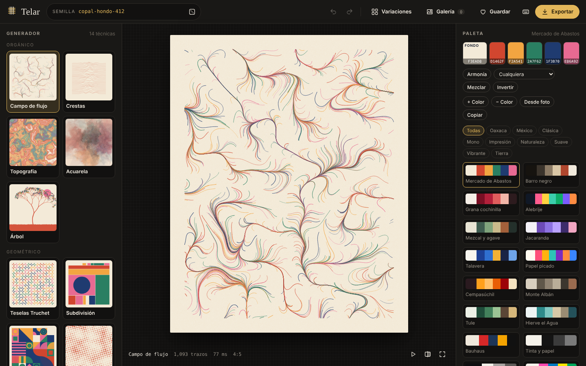
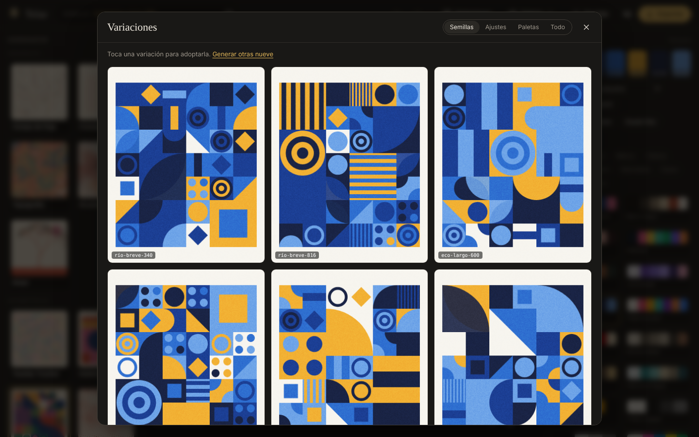

# Telar

**Estudio de arte generativo que corre en el navegador.** Catorce técnicas, más de treinta paletas (varias inspiradas en Oaxaca), acabados de impresión y exportación a PNG, JPG, SVG vectorial y video. Sin dependencias, sin servidor y sin paso de compilación: abre `index.html` y empieza a tejer.



## Qué puedes hacer

### 14 generadores
| Familia | Técnicas |
| --- | --- |
| Orgánico | Campo de flujo · Crestas · Topografía · Acuarela · Árbol |
| Geométrico | Teselas Truchet · Subdivisión · Rejilla Bauhaus · Trama de semitonos · Ondas y moiré |
| Matemático | Atractor extraño (Clifford, De Jong, Svensson, Bedhead) · Mosaico Voronoi · Empaquetado de círculos · Tejido modular |

Cada generador expone sus propios ajustes (de 7 a 14 controles): densidad, ruido, octavas, deformación, márgenes, modos de color, mezclas, etc. Cada control tiene un dado para darle un valor al azar.

### Azar reproducible
- **Semillas legibles** (`copal-hondo-412`): la misma semilla con los mismos ajustes da siempre la misma obra.
- **Historial** con deshacer y rehacer, y botón **Comparar** (mantén pulsado para ver la versión anterior).
- **Mutar** mueve todos los ajustes un poco; **Azar** los reparte por completo.
- **Variaciones**: una cuadrícula de 9 alternativas por semilla, ajustes, paletas o todo a la vez. Toca una para adoptarla.

### Color
- 32 paletas curadas por tema: Oaxaca, México, impresión, naturaleza, suaves, vibrantes, tierra y monocromas.
- **Armonías** (análoga, complementaria, triádica, tetrádica, complementaria dividida, monocromática) que respetan los colores que fijes con el candado.
- **Paleta desde foto**: sube o arrastra una imagen y Telar extrae sus colores con k-means.
- Edición de cada color, agregar o quitar tintas, invertir fondo, mezclar y copiar como variables CSS.

### Lienzo y acabado
- 12 proporciones: cuadrada, retrato, historias, pantalla de teléfono, papel ISO A, paisaje y panorámica.
- Grano de película, textura de papel, viñeta, marco *passe-partout* en cuatro colores y firma opcional.

### Exportación
- **PNG o JPG** hasta 8192 px de lado largo, con plantillas para Instagram, historias, fondos de teléfono, escritorio 4K y A4/A3 a 300 ppp.
- **SVG vectorial** para editar en Illustrator o Inkscape, o para trazar con plotter (las capas raster se incrustan).
- **Video** de la obra tejiéndose trazo a trazo (MP4 o WebM según el navegador).
- **Receta JSON** para volver a abrir la obra exacta, y **enlace compartible** con todo el estado en la URL.

### Galería y flujo
- Galería local con miniaturas, importación y exportación en JSON.
- Animación de construcción, pantalla completa, doble clic en la obra para una semilla nueva.
- Arrastra una foto (paleta) o una receta `.json` sobre la ventana para cargarla.
- Interfaz adaptada a móvil con pestañas inferiores.



## Atajos de teclado

| Tecla | Acción |
| --- | --- |
| `Espacio` / `N` | Nueva semilla |
| `Z` / `Y` | Deshacer / rehacer |
| `M` / `A` | Mutar ajustes / ajustes al azar |
| `P` / `H` | Paleta curada al azar / nueva armonía |
| `V` | Variaciones |
| `B` | Animar construcción |
| `S` / `G` | Guardar en galería / abrir galería |
| `E` | Exportar |
| `F` | Pantalla completa |
| `←` `→` | Generador anterior / siguiente |
| `?` | Ayuda |

## Uso

```bash
git clone https://github.com/dezenbit/telar.git
cd telar
# Abre index.html directamente o sirve la carpeta:
python3 -m http.server 8080
```

No hay paquetes que instalar. Las tipografías se cargan desde Google Fonts; sin conexión se usan las del sistema.

### Publicar en GitHub Pages
El repositorio incluye `.github/workflows/pages.yml`. En GitHub ve a **Settings → Pages → Build and deployment** y elige **GitHub Actions**. Cada push a `main` publica el sitio.

## Estructura

```
telar/
├── index.html
├── css/telar.css
└── js/
    ├── core.js              azar con semilla, ruido simplex, color, Pen (trazos → Canvas y SVG)
    ├── palettes.js          paletas, armonías y extracción desde imagen
    ├── render.js            generación, marco, acabados, firma y SVG final
    ├── app.js               interfaz, historial, galería, exportación y atajos
    └── generators/
        ├── organic.js
        ├── geometric.js
        └── mathematical.js
```

## Agregar un generador

Los generadores dibujan con un objeto `pen` que graba trazos en un mundo de 1000 unidades de ancho. Esa misma lista de trazos se pinta en Canvas, se exporta a SVG y se anima en video, así que un generador nuevo obtiene todo eso sin código extra.

```js
Telar.register({
  id: 'lluvia',
  name: 'Lluvia',
  family: 'Orgánico',
  desc: 'Gotas verticales con longitud aleatoria.',
  params: [
    { key: 'drops', label: 'Gotas', type: 'range', min: 50, max: 3000, step: 10, def: 600 },
    { key: 'colorful', label: 'Varios colores', type: 'toggle', def: true },
  ],
  draw({ pen, w, h, rng, noise, pal, p }) {
    pen.background(pal.bg);
    for (let i = 0; i < p.drops; i++) {
      const x = rng.float(0, w), y = rng.float(0, h), len = rng.float(10, 80);
      pen.line(x, y, x, y + len, { stroke: p.colorful ? rng.pick(pal.colors) : pal.colors[0], lw: 1.5 });
    }
  },
});
```

Guárdalo en `js/generators/` y añade su `<script>` en `index.html`. Tipos de control disponibles: `range`, `select`, `toggle` y `text`.

## Compatibilidad

Chrome, Edge, Firefox y Safari recientes, en escritorio y móvil. El video necesita `MediaRecorder` (Safari graba MP4; Chrome y Firefox, WebM).

## Licencia

[MIT](LICENSE) © 2026 Dezen
